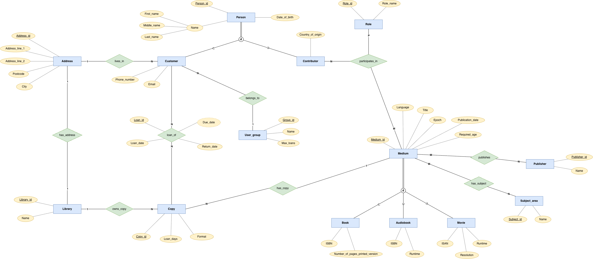

# Library System — Database Technologies Semester Project

Semester group project for the **Database Technologies** module (HS26). The
task: design and implement a database for an administrative system in a
chosen domain. Our topic is a **library system** — managing media (books,
audiobooks, movies), customers, loans, contributors (authors, narrators,
directors), publishers, subject areas, and library locations.

The project counts for 30% of the module grade. See
[`project_requirements/`](project_requirements) for the original brief.

## Tech stack

- **MySQL** — the relational model is implemented as a MySQL database with
  SQL DDL for schema creation and sample queries for analysis.

## ER model

The entity-relationship model below is finalized and drives the relational
schema.



## Repository structure

```
.
├── AGENTS.md                 # entry point for coding agents working in this repo
├── docs/                     # project artifacts (ER diagram)
├── project_requirements/     # the given project brief and grading criteria
├── skills/                   # reference docs for coding agents (model + deliverables detail)
├── sql/                      # SQL deliverables, run in numeric order
│   ├── 01_schema.sql         #   DDL: CREATE TABLE + constraints (+ ALTER/triggers if added)
│   ├── 02_seed_data.sql      #   INSERT test data
│   └── 03_queries.sql        #   analytical queries (join + aggregation + GROUP BY)
└── README.md
```

## Deliverables

- [ ] Requirements description
- [ ] ER model
- [ ] Relational model as SQL DDL (foreign keys defined)
- [ ] At least one complex SQL query (join + aggregation + `GROUP BY`) with test data
- [ ] Short reflection

## Contributors

- [Alex Lengyel](https://github.com/AlexLengyel)
- [Justin Vogler](https://github.com/JustinVfhnw)
- [Pascal Walther](https://github.com/PascalW24)
- [Dennis Berg](https://github.com/DBRGGTHB)
